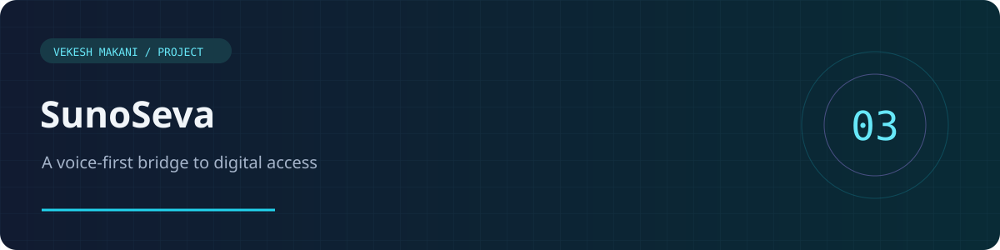
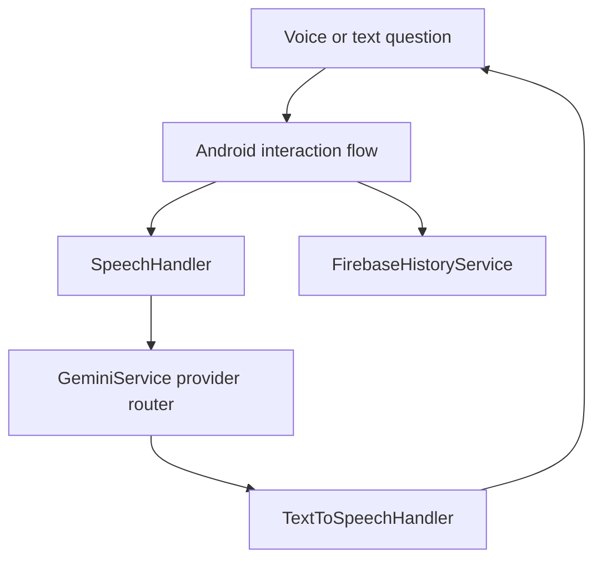

<div align="center">



**Speak naturally. Receive guidance. Access digital services.**

`Android` · `Java` · `Speech Recognition` · `Text-to-Speech` · `Firebase`

[Portfolio](https://vekeshportfolio.lovable.app/) · [Developer profile](https://github.com/Vekesh04)

</div>

## Why SunoSeva?

Digital interfaces can be difficult for people with limited literacy or limited familiarity with technology. **SunoSeva** is a multilingual Android assistant designed to let people ask questions by voice and hear step-by-step guidance in their selected language.

## Highlights

- Regional-language selection for voice input and spoken output.
- Android speech recognition and text-to-speech integration.
- A microphone-led interaction flow with listening, processing, and speaking states.
- AI-generated guidance using configurable OpenAI-compatible providers.
- Manual text input and local fallback responses for selected scenarios.
- Interaction history using Firebase Anonymous Authentication, Firestore, and Storage.

Language availability depends on the device recognition service, installed voices, and network conditions. Telugu is the default in the source.

## Architecture



The class named `GeminiService` currently routes OpenAI-compatible requests to OpenAI, OpenRouter, or Groq; its name should not be read as a claim that this version uses the Gemini API.

## Set up and run

1. Open this repository in Android Studio.
2. Install the Android SDK components requested by Gradle (the app targets SDK 35 and supports API 26+).
3. Create `local.properties` using `local.properties.example` as a guide. Add your local SDK path and an appropriate provider key.
4. Configure your own Firebase Android app with package name `com.example.sunoseva`, and place its configuration at `app/google-services.json`.
5. Enable the Firebase services described in [FIREBASE_SETUP.md](FIREBASE_SETUP.md).
6. Sync Gradle, connect an Android device or emulator, and run the app. Grant microphone permission when prompted.

Optional command-line build after local configuration:

```bash
# macOS/Linux
chmod +x gradlew
./gradlew assembleDebug
# Windows
gradlew.bat assembleDebug
```

## Source map

| File | Responsibility |
| --- | --- |
| `MainActivity.java` | UI, language selection, interaction lifecycle, and fallbacks |
| `SpeechHandler.java` | Speech recognition |
| `TextToSpeechHandler.java` | Spoken responses |
| `GeminiService.java` | Provider selection and response processing |
| `FirebaseHistoryService.java` | Authentication and interaction history |
| `app/src/main/res/` | Screens, strings, themes, and visual states |

Java files are under `app/src/main/java/com/example/sunoseva/`.

## Prototype boundaries

Provider keys configured through BuildConfig are bundled into the Android application. For a production release, route requests through a secured backend rather than shipping provider credentials. Use a development Firebase project and test interactions while evaluating the app. AI guidance may be incomplete; verify important service requirements with official sources. No API keys, Firebase project configuration, local caches, or compiled APKs are included in this public source.

## Author

**Vekesh Makani** · AI Engineer & Python Developer

[Portfolio](https://vekeshportfolio.lovable.app/) · [LinkedIn](https://linkedin.com/in/vekesh-m)
